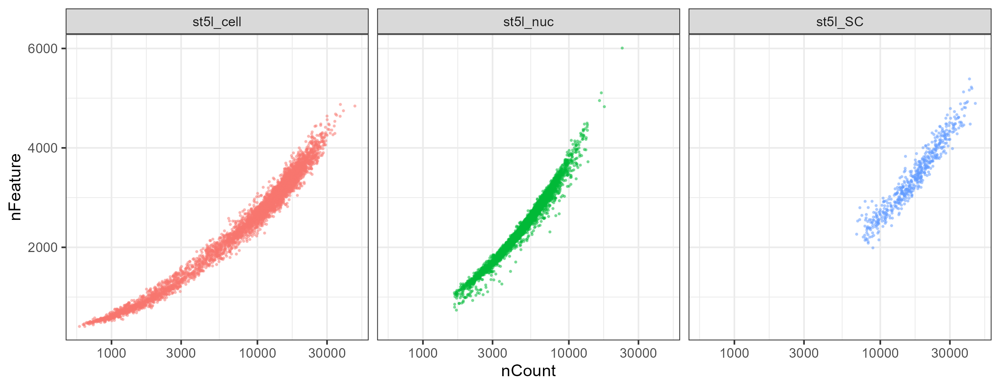
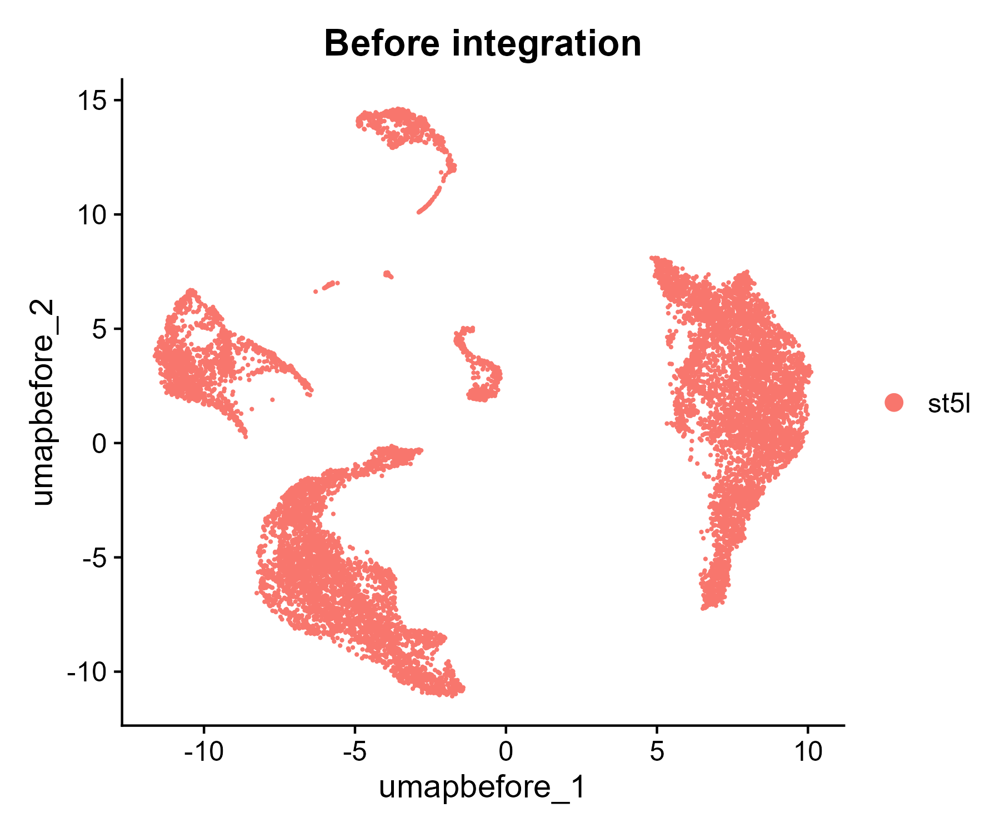
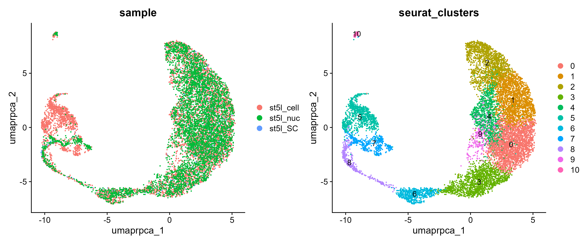
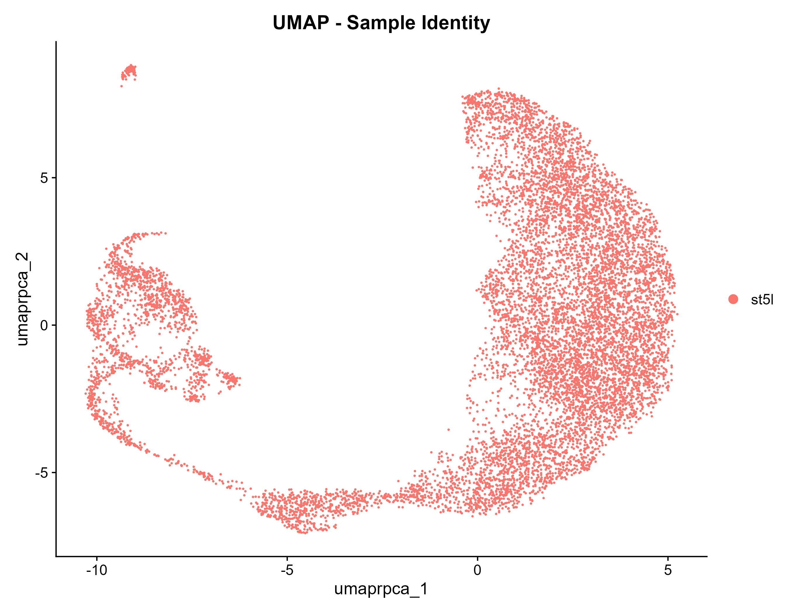
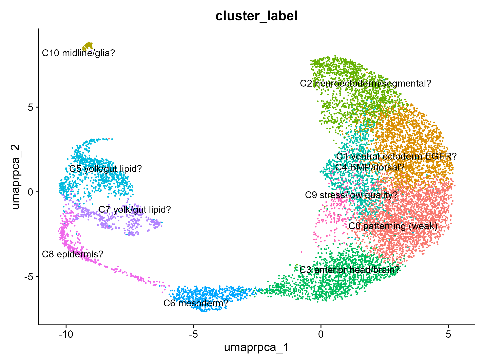
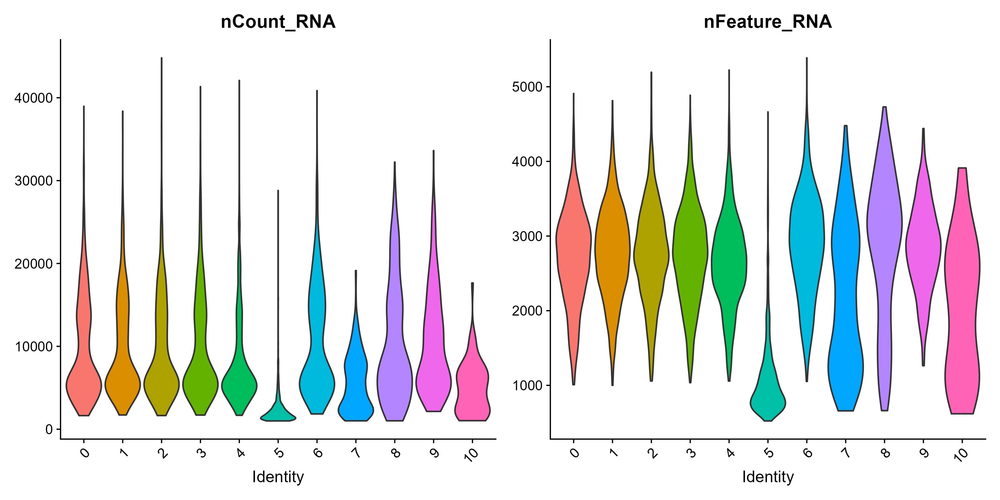
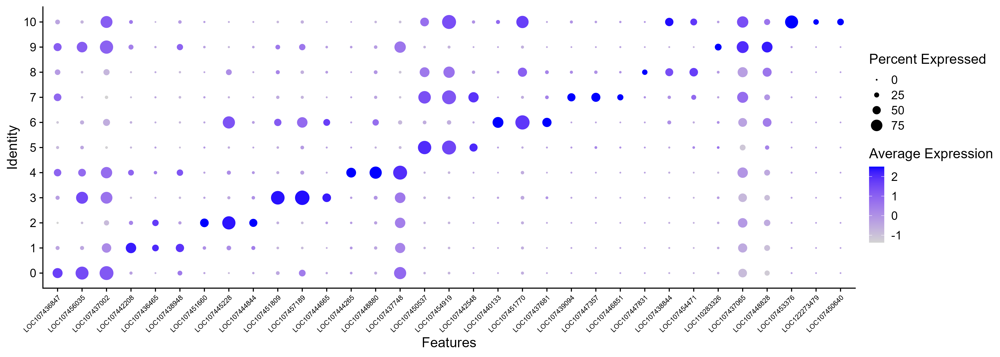
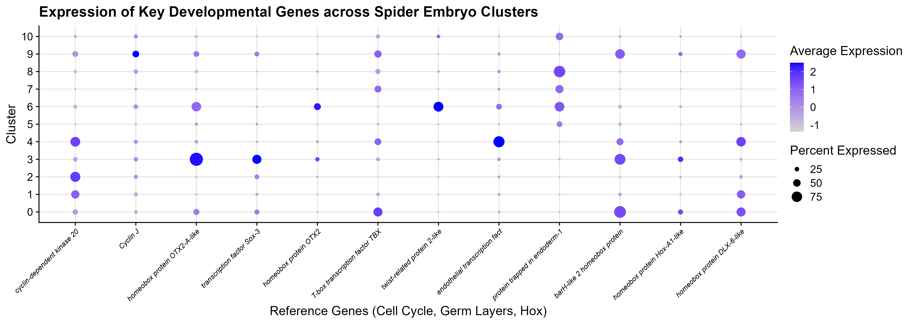

# Spider-scRNAseq

Single-cell RNA-seq analysis of *Parasteatoda tepidariorum* embryos (stage 5 late, GEO: [GSE201705](https://www.ncbi.nlm.nih.gov/geo/query/acc.cgi?acc=GSE201705)) with R and Seurat.

**Author:** Kanashi13 (Saman)

## Overview

Three BD Rhapsody samples (whole cells, nuclei, and a small single-cell sample) were filtered, integrated with RPCA, clustered, and provisionally annotated using NCBI gene descriptions.

| Sample | Cells before filtering | Cells after filtering |
|---|---|---|
| st5l_SC | 552 | 551 |
| st5l_cell | 5,361 | 5,188 |
| st5l_nuc | 5,145 | 5,127 |
| **Total** | | **10,866** |

## Pipeline

| Script | Purpose |
|---|---|
| `scripts/00_setup.R` | Load packages and create output folders |
| `scripts/01_download_data.R` | Download and extract GSE201705 from GEO |
| `scripts/02_read_and_filter.R` | Read count matrices, QC plots, per-sample filtering |
| `scripts/03_integrate.R` | Merge samples, normalize, PCA, RPCA integration, clustering, UMAP |
| `scripts/04_cluster_analysis.R` | Cluster QC, sample composition, marker detection |
| `scripts/05_cluster_annotation.R` | NCBI gene descriptions, provisional labels, marker dot plots |

## Usage

```r
setwd("path/to/Spider-scRNAseq")
install.packages(c("Seurat", "data.table", "Matrix", "dplyr", "ggplot2", "patchwork", "rentrez"))

source("scripts/01_download_data.R")
source("scripts/02_read_and_filter.R")
source("scripts/03_integrate.R")
source("scripts/04_cluster_analysis.R")
source("scripts/05_cluster_annotation.R")
```

Raw data and `.rds` objects are not included in this repository. Script 01 downloads the raw data from GEO.

## Results

### Quality control

Gene and UMI counts differ between protocols, so thresholds were set per sample.



### Integration

Before integration, nuclei and whole cells form separate groups. After RPCA integration the samples overlap.







### Clusters

Eleven clusters (0 to 10) were found at resolution 0.5.





### Markers





## Provisional cluster labels

Labels come from NCBI gene descriptions of cluster markers and known developmental genes. They are hypotheses and have not been checked against the original publication.

| Cluster | Provisional label | Key genes |
|---|---|---|
| 0 | Patterning (weak markers) | TBX20, barH-like 2, Hox-A1-like |
| 1 | Ventral ectoderm, EGFR signaling | spitz, rhomboid, chordin/sog |
| 2 | Neuroectoderm / segmental | gooseberry, argos, Wnt5b |
| 3 | Anterior head / brain | OTX2, Sox-3, tailless |
| 4 | BMP signaling / dorsal | noggin-2, GATA-like, DLX-6-like |
| 5, 7 | Yolk / gut lipid metabolism | FABP, lipases, sterol O-acyltransferase |
| 6 | Mesoderm | twist-related, FGFR |
| 8 | Epidermis | chitin synthase |
| 9 | Proliferating | Cyclin J |
| 10 | Midline / glia | slit, Ets pointed, EAAT |

## Limitations

- The reference annotation contains no mitochondrial genes, so mitochondrial percentage could not be used for QC.
- Most genes are named `LOC...` and were annotated through NCBI Gene.
- Clusters 5 and 7 are found almost only in the whole-cell sample and have low UMI counts.
- Clusters 0 and 1 have weak markers and may be part of a continuum.
- Cluster labels are provisional.

## Environment

R 4.5, Seurat with the v5 layer workflow, Windows 11.
